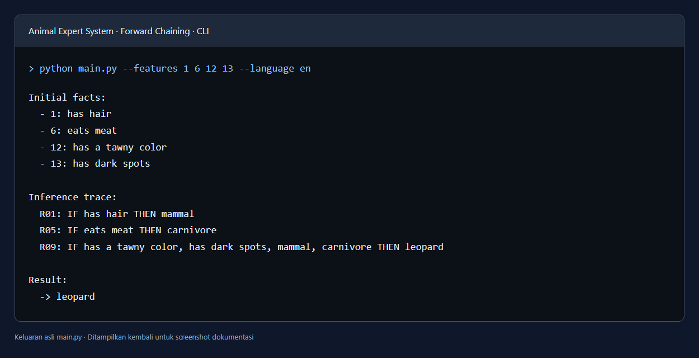
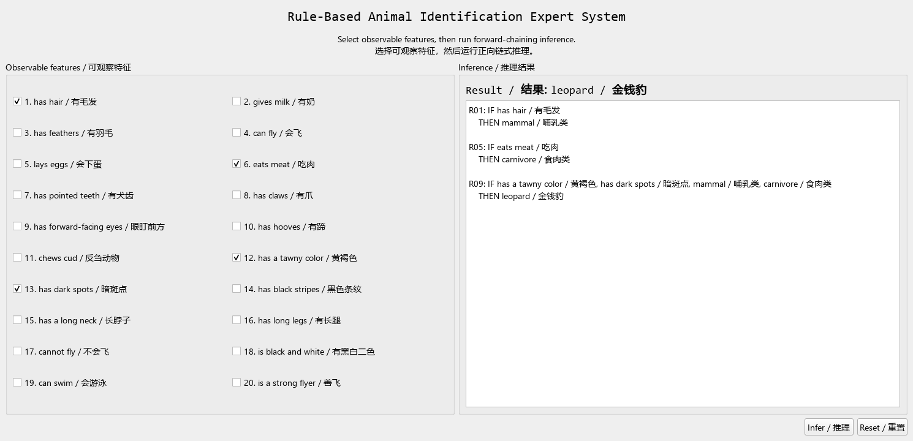

# Expert System — Identifikasi Hewan dengan Forward Chaining

## 1. Introduction

Program Python ini mengidentifikasi hewan berdasarkan ciri yang dipilih
pengguna. **Sistem pakar berbasis aturan** ini memakai basis pengetahuan
berupa aturan IF–THEN dan mesin inferensi **forward chaining**.

Program memiliki 20 ciri yang dapat diamati, 4 kategori perantara, 15 aturan,
dan 7 kemungkinan hewan: leopard (macan tutul), tiger (harimau), giraffe
(jerapah), zebra, ostrich (burung unta), penguin, dan albatross.

Alurnya: ciri masukan menjadi fakta awal; mesin memeriksa aturan; kesimpulan
baru dimasukkan sebagai fakta; pemeriksaan diulang sampai tidak ada fakta
baru. Karena kesimpulan dapat dipakai aturan berikutnya, proses ini benar-benar
melakukan penalaran bertahap.

Contoh: `has hair` menghasilkan `mammal`, dan `eats meat` menghasilkan
`carnivore`. Kedua kesimpulan tersebut, ditambah warna tawny dan dark spots,
menghasilkan `leopard`. Program menampilkan jejak aturan yang digunakan.

Ini adalah demonstrasi pendidikan dengan basis pengetahuan terbatas. Fakta
yang kurang dapat menghasilkan tanpa kesimpulan, sedangkan gabungan ciri
tertentu dapat menghasilkan lebih dari satu hewan. Program tidak memberikan
skor probabilitas dan tidak menyelesaikan pertentangan antar-ciri.

| File/folder | Fungsi |
| --- | --- |
| `main.py` | Peluncur CLI tanpa instalasi paket |
| `src/animal_expert_system/engine.py` | Mesin inferensi forward chaining |
| `src/animal_expert_system/knowledge_base.py` | Membaca dan memvalidasi basis pengetahuan |
| `src/animal_expert_system/data/knowledge_base.json` | Ciri, kategori, hewan, dan aturan IF–THEN |
| `src/animal_expert_system/cli.py` | Antarmuka terminal asli |
| `src/animal_expert_system/models.py` | Struktur data konsep, aturan, dan hasil |
| `tests/` dan `run_tests.py` | Unit test asli dan peluncur tes |
| `README_UPSTREAM.md` | README asli dari penulis sumber |
| `LICENSE` | Lisensi MIT asli |
| `verification.txt` | Hasil pengujian paket |

## 2. Requirements

- Python **3.10 atau lebih baru**.
- Untuk terminal/CLI: **tidak ada library pihak ketiga** dan tidak perlu `pip install`.
- Modul standar yang digunakan: `argparse`, `json`, `dataclasses`,
  `importlib.resources`, `pathlib`, `typing`, dan `sys`.
- Modul standar `unittest` digunakan untuk tes bawaan.
- Source GUI opsional juga disertakan; mode GUI membutuhkan `PyQt5>=5.15`.
  GUI tidak diperlukan untuk mengikuti langkah terminal di bawah.

## 3. How to Use

1. Ekstrak `Expert_System_Forward_Chaining.zip`.
2. Buka terminal di folder `Expert_System_Forward_Chaining` yang berisi `main.py`.

3. Tampilkan ciri beserta nomor ID-nya:

   ```bash
   python main.py --list-features --language en
   ```

4. Jalankan identifikasi macan tutul:

   ```bash
   python main.py --features 1 6 12 13 --language en
   ```

   Masukan tersebut berarti memiliki rambut, makan daging, berwarna tawny,
   dan memiliki bintik gelap. Bagian akhir hasilnya:

   ```text
   Result:
     -> leopard
   ```

5. Coba contoh lain:

   ```bash
   python main.py --features 1 6 12 14 --language en
   python main.py --features 3 17 18 19 --language en
   python main.py --features 1 --language en
   ```

   Hasil berturut-turut: `tiger`, `penguin`, dan belum dapat mengidentifikasi
   hewan karena ciri tidak cukup.

Gunakan ID ciri **1–20**, dipisahkan spasi, bukan koma. ID kategori perantara
dan ID hewan tidak boleh dimasukkan sebagai ciri awal. ID tidak valid akan
ditolak. Semua ciri yang dimasukkan diperlakukan sebagai benar; ciri yang tidak
dipilih dianggap belum diketahui, bukan otomatis salah.

`--language en` memilih keluaran bahasa Inggris. Pilihan lain dari source asli
adalah `zh` dan `bilingual`. Menjalankan `python main.py` tanpa argumen akan
menampilkan bantuan; program ini menerima ciri lewat argumen terminal.

Jalankan 11 unit test bawaan:

```bash
python run_tests.py
```

Di Windows, ganti `python` dengan `py` bila diperlukan. Di macOS/Linux gunakan
`python3` jika perintah Python tersedia dengan nama tersebut. Simpan folder
`src` beserta file JSON-nya; jangan memindahkan `main.py` sendirian.

### Screenshot hasil running

Contoh hasil menjalankan identifikasi macan tutul:

```bash
python main.py --features 1 6 12 13 --language en
```



Screenshot menampilkan keluaran asli CLI yang ditampilkan kembali dalam
tampilan terminal untuk dokumentasi. Aturan `R01` menghasilkan `mammal`,
`R05` menghasilkan `carnivore`, dan `R09` mengidentifikasi `leopard`.

### GUI opsional

Jika ingin mencoba GUI opsional, dari folder `Expert_System_Forward_Chaining` jalankan:

```bash
python -m pip install -e ".[gui]"
animal-expert-gui
```

Instalasi GUI memerlukan akses internet dan lingkungan desktop.

### Screenshot hasil GUI

Screenshot berikut diambil dari GUI PyQt5 asli setelah ciri **1, 6, 12, dan 13**
dicentang dan tombol **Infer** dijalankan.



Panel kiri berisi pilihan ciri, sedangkan panel kanan menampilkan hasil
**leopard / macan tutul** dan jejak inferensi: `R01` menghasilkan `mammal`,
`R05` menghasilkan `carnivore`, lalu `R09` menghasilkan `leopard`.
Tombol **Reset** menghapus pilihan ciri dan hasil inferensi.

Verifikasi GUI mencakup pemilihan ciri tersebut, tombol **Infer**, hasil
`leopard`, jejak aturan `R01`, `R05`, dan `R09`, serta tombol **Reset**.
Screenshot diambil dengan rendering Qt tanpa menampilkan jendela di desktop;
font Windows dimuat untuk memastikan teks terlihat. Verifikasi CLI dan mesin
inferensi juga telah lulus melalui 11 unit test bawaan.

## 4. Basis Pengetahuan

Seluruh ciri, kategori, aturan, dan kemungkinan hewan berikut berasal dari
[knowledge_base.json](src/animal_expert_system/data/knowledge_base.json).
File `knowledge_base.py` membaca dan memvalidasi data tersebut.

### 20 ciri yang dapat dipilih

ID 1–20 digunakan sebagai fakta awal melalui argumen CLI atau checkbox GUI.

| ID | Ciri di program | Arti |
| --- | --- | --- |
| 1 | `has hair` | Memiliki rambut |
| 2 | `gives milk` | Menghasilkan susu |
| 3 | `has feathers` | Memiliki bulu unggas |
| 4 | `can fly` | Bisa terbang |
| 5 | `lays eggs` | Bertelur |
| 6 | `eats meat` | Makan daging |
| 7 | `has pointed teeth` | Memiliki gigi runcing |
| 8 | `has claws` | Memiliki cakar |
| 9 | `has forward-facing eyes` | Memiliki mata menghadap ke depan |
| 10 | `has hooves` | Memiliki kuku seperti kuda atau sapi |
| 11 | `chews cud` | Memamah biak |
| 12 | `has a tawny color` | Berwarna cokelat kekuningan |
| 13 | `has dark spots` | Memiliki bintik gelap |
| 14 | `has black stripes` | Memiliki garis belang hitam |
| 15 | `has a long neck` | Memiliki leher panjang |
| 16 | `has long legs` | Memiliki kaki panjang |
| 17 | `cannot fly` | Tidak bisa terbang |
| 18 | `is black and white` | Berwarna hitam dan putih |
| 19 | `can swim` | Bisa berenang |
| 20 | `is a strong flyer` | Memiliki kemampuan terbang yang kuat |

### 4 kategori perantara

Kategori berikut disimpulkan oleh mesin inferensi dan dapat menjadi syarat
bagi aturan berikutnya. Kategori ini tidak dimasukkan sebagai fakta awal.

| ID | Kategori | Arti |
| --- | --- | --- |
| 21 | `mammal` | Mamalia |
| 22 | `bird` | Burung |
| 23 | `carnivore` | Karnivora |
| 24 | `ungulate` | Hewan berkuku (ungulate) |

### 15 aturan IF–THEN

Semua syarat yang dihubungkan dengan **dan** harus terpenuhi. Ketika
kesimpulan suatu aturan belum diketahui, kesimpulan tersebut ditambahkan
ke memori kerja dan dapat langsung dipakai oleh aturan berikutnya.

| Aturan | IF — Syarat | THEN — Kesimpulan |
| --- | --- | --- |
| `R01` | Memiliki rambut | Mamalia |
| `R02` | Menghasilkan susu | Mamalia |
| `R03` | Memiliki bulu unggas | Burung |
| `R04` | Bisa terbang **dan** Bertelur | Burung |
| `R05` | Makan daging | Karnivora |
| `R06` | Memiliki gigi runcing **dan** Memiliki cakar **dan** Memiliki mata menghadap ke depan | Karnivora |
| `R07` | Memiliki kuku seperti kuda atau sapi **dan** Mamalia | Hewan berkuku (ungulate) |
| `R08` | Memamah biak **dan** Mamalia | Hewan berkuku (ungulate) |
| `R09` | Mamalia **dan** Karnivora **dan** Berwarna cokelat kekuningan **dan** Memiliki bintik gelap | Macan tutul |
| `R10` | Mamalia **dan** Karnivora **dan** Berwarna cokelat kekuningan **dan** Memiliki garis belang hitam | Harimau |
| `R11` | Hewan berkuku (ungulate) **dan** Memiliki leher panjang **dan** Memiliki kaki panjang **dan** Memiliki bintik gelap **dan** Menghasilkan susu | Jerapah |
| `R12` | Hewan berkuku (ungulate) **dan** Memiliki garis belang hitam | Zebra |
| `R13` | Burung **dan** Memiliki leher panjang **dan** Memiliki kaki panjang **dan** Tidak bisa terbang **dan** Berwarna hitam dan putih | Burung unta |
| `R14` | Burung **dan** Bisa berenang **dan** Tidak bisa terbang **dan** Berwarna hitam dan putih | Penguin |
| `R15` | Burung **dan** Memiliki kemampuan terbang yang kuat | Albatros |

### 7 kemungkinan hewan

Berikut hewan yang dapat menjadi hasil identifikasi sesuai aturan di atas.

| ID | Nama keluaran program | Arti |
| --- | --- | --- |
| 25 | `leopard` | Macan tutul |
| 26 | `tiger` | Harimau |
| 27 | `giraffe` | Jerapah |
| 28 | `zebra` | Zebra |
| 29 | `ostrich` | Burung unta |
| 30 | `penguin` | Penguin |
| 31 | `albatross` | Albatros |

Contoh: ciri **3, 17, 18, dan 19** menghasilkan `penguin`. Aturan `R03`
menyimpulkan `bird`, lalu `R14` menggabungkannya dengan ciri tidak bisa
terbang, berwarna hitam-putih, dan bisa berenang.

## 5. Source / Referensi

- Repositori: [Waldo0926/animal-expert-system](https://github.com/Waldo0926/animal-expert-system).
- Penulis versi publik: **Shuoxun Wen**.
- Snapshot: [commit d80e0450f4c796e84fb4f1adff2f5b72497addf9](https://github.com/Waldo0926/animal-expert-system/tree/d80e0450f4c796e84fb4f1adff2f5b72497addf9).
- Source inti: [engine.py](https://github.com/Waldo0926/animal-expert-system/blob/d80e0450f4c796e84fb4f1adff2f5b72497addf9/src/animal_expert_system/engine.py).
- Lisensi MIT disertakan di `LICENSE`; riwayat atribusi ada di
  `docs/coursework-origin.md`.
- Source dalam `src/`, data, unit test, dan dokumentasi `docs/` disertakan
  tanpa perubahan.
- Tambahan paket: `main.py`, `run_tests.py`, `requirements.txt`, dan README
  berbahasa Indonesia ini. README asli disimpan sebagai `README_UPSTREAM.md`;
  requirements asli sebagai `requirements_gui_upstream.txt`. Referensi README
  pada `pyproject.toml` disesuaikan dengan nama file tersebut.
- Detail URL, checksum asli, dan perubahan kemasan ada di
  `source_manifest.json`.

Cantumkan sumber asli saat memakai program ini dalam tugas. Kode inti bukan
karya baru dari penyusun paket.
