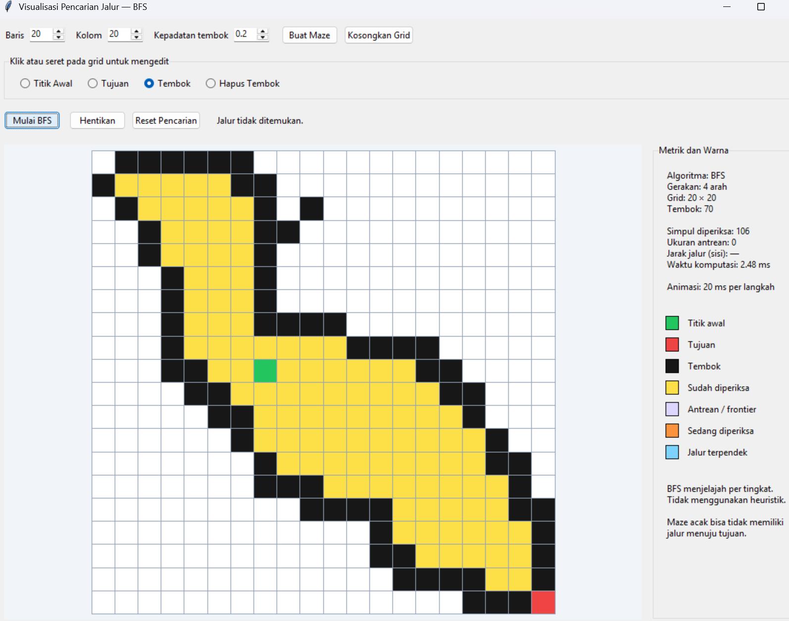
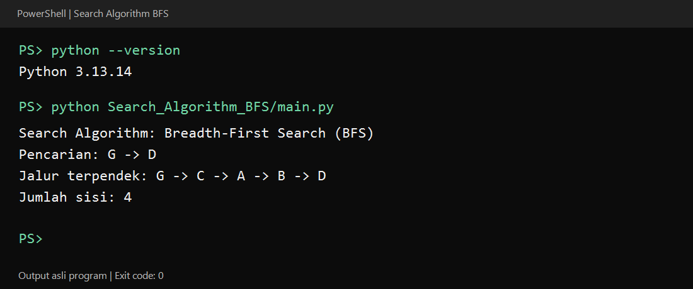

# Search Algorithm: Breadth-First Search (BFS)

## 1. Introduction

Program Python ini mencari **jalur terpendek pada graf tidak berbobot**
menggunakan algoritma **Breadth-First Search (BFS)**. BFS menelusuri simpul
secara bertingkat menggunakan antrean FIFO (*First In, First Out*).

Program menerima simpul awal dan simpul tujuan, kemudian menampilkan jalur
yang ditemukan serta jumlah sisinya. Jalur terpendek berarti jalur dengan
jumlah sisi paling sedikit, bukan biaya atau jarak berbobot.

Contoh pencarian dari simpul G menuju D menghasilkan:

```text
G -> C -> A -> B -> D
```

Jumlah sisi yang dilalui adalah **4**. Jika terdapat beberapa jalur sama pendek,
hasil mengikuti urutan tetangga yang diperiksa pada graf.

Kode inti berasal dari **TheAlgorithms/Python**, sedangkan `main.py` dan
README berbahasa Indonesia ini ditambahkan untuk memudahkan penggunaannya.

| File | Fungsi |
| --- | --- |
| `main.py` | Menjalankan demo dan menerima pilihan simpul |
| `bfs_visualizer.py` | GUI grid dan animasi pencarian BFS |
| `breadth_first_search_shortest_path_2.py` | Implementasi BFS asli beserta graf contoh |
| `requirements.txt` | Keterangan dependensi program |
| `readme.md` | Penjelasan dan cara penggunaan |
| `LICENSE.md` | Lisensi MIT dari repository sumber |
| `source_manifest.json` | URL, commit, dan checksum berkas sumber |
| `verification.txt` | Hasil verifikasi program |

## 2. Requirements

- **Python 3.10 atau lebih baru**.
- Library pihak ketiga: **tidak ada**; tidak perlu menjalankan `pip install`.
- Modul bawaan Python yang digunakan:
  - `collections`: menyediakan `deque` untuk antrean BFS.
  - `argparse`: membaca simpul awal dan tujuan dari argumen terminal.
  - `doctest`: menjalankan pengujian contoh pada source code, jika diperlukan.
- Terminal Windows, macOS, atau Linux. VS Code bersifat opsional.

Cek instalasi Python:

```bash
python --version
```

## 3. How to Use

1. Ekstrak `Search_Algorithm_BFS.zip`.
2. Buka terminal di folder `Search_Algorithm_BFS` yang berisi `main.py`.
3. Jalankan program:

   ```bash
   python main.py
   ```

   Secara default, program mencari jalur dari G ke D. Hasilnya:

   ```text
   Search Algorithm: Breadth-First Search (BFS)
   Pencarian: G -> D
   Jalur terpendek: G -> C -> A -> B -> D
   Jumlah sisi: 4
   ```

4. Untuk mengganti simpul awal dan tujuan:

   ```bash
   python main.py --start A --goal F
   ```

   Hasilnya:

   ```text
   Search Algorithm: Breadth-First Search (BFS)
   Pencarian: A -> F
   Jalur terpendek: A -> C -> F
   Jumlah sisi: 2
   ```

Pilihan simpul pada contoh adalah **A, B, C, D, E, F, G**, dengan huruf kapital.
Program menolak pilihan di luar daftar tersebut. Jika simpul awal dan tujuan
sama, jumlah sisi adalah 0.

Untuk menampilkan bantuan:

```bash
python main.py --help
```

Untuk menjalankan file source asli secara langsung:

```bash
python breadth_first_search_shortest_path_2.py
```

Untuk menjalankan enam pengujian contoh bawaan source:

```bash
python -m doctest -v breadth_first_search_shortest_path_2.py
```

Jika `python` tidak dikenali, coba `py` di Windows atau `python3` di macOS/Linux.
Pastikan terminal berada di folder yang benar dan kedua file Python tetap
berada dalam satu folder.

Graf dapat diubah melalui variabel `demo_graph` pada file source. Setiap
simpul yang menjadi tetangga harus memiliki entri sendiri. Daftar tetangga
menentukan arah perjalanan; graf asli tidak sepenuhnya simetris. Contohnya,
E dapat menuju D, tetapi daftar tetangga D hanya berisi B.

Fungsi `bfs_shortest_path` menghasilkan daftar simpul pada jalur, atau `[]`
jika tidak ditemukan. Fungsi `bfs_shortest_path_distance` menghasilkan jumlah
sisi, atau `-1` jika tidak ada jalur. Saat memakai fungsi secara langsung,
pastikan simpul awal valid; peluncur `main.py` sudah memvalidasi pilihan simpul.

### Visualisasi GUI

Untuk membuka jendela visualisasi grid, jalankan dari folder utama repository:

```powershell
python Search_Algorithm_BFS/main.py --gui
```

Jika terminal berada di folder yang berisi `main.py`, gunakan `python main.py --gui`.
GUI memakai **Tkinter**, yang sudah tersedia pada Python di komputer ini.
Argumen `--start` dan `--goal` digunakan untuk demo terminal; pada GUI, pilih
titik awal dan tujuan langsung dengan mengklik grid.

1. Pilih ukuran grid dan kepadatan tembok, lalu klik **Buat Maze**.
2. Pilih **Titik Awal**, **Tujuan**, **Tembok**, atau **Hapus Tembok**, kemudian
   klik atau seret pada grid.
3. Klik **Mulai BFS** untuk melihat pencarian secara bertahap.
4. Gunakan **Hentikan** untuk menghentikan animasi, **Reset Pencarian** untuk
   menghapus hasil pencarian, atau **Kosongkan Grid** untuk menghapus tembok.

Hijau menandai titik awal, merah tujuan, hitam tembok, kuning simpul yang
sudah diperiksa, ungu antrean, oranye simpul yang sedang diperiksa, dan biru
jalur terpendek. Panel di sebelah kanan menampilkan jumlah simpul diperiksa,
ukuran antrean, jumlah sisi pada jalur, dan waktu komputasi tanpa jeda animasi.

Visualisasi ini menggunakan **BFS dengan gerakan empat arah dan biaya setiap
sisi 1**. BFS tidak memerlukan heuristik. Maze acak tidak selalu memiliki jalur;
jika pencarian gagal, hapus sebagian tembok atau buat maze baru.

Implementasi grid dan GUI dibuat untuk paket pembelajaran ini. Kode BFS asli
dari TheAlgorithms tetap digunakan oleh demo terminal.

#### Screenshot GUI



Screenshot ini memperlihatkan pencarian pada grid **20 × 20** dengan **70 tembok**.
BFS telah memeriksa **106 simpul** dan antreannya sudah kosong. Status
**Jalur tidak ditemukan** berarti tidak ada jalur yang menghubungkan titik awal
dengan tujuan pada susunan tembok tersebut. Untuk mencoba susunan lain,
hapus sebagian tembok atau klik **Buat Maze**.

### Hasil Run Berhasil

Program berhasil dijalankan menggunakan **Python 3.13.14** yang terpasang
di komputer, dengan exit code `0`. Pencarian dari simpul **G**
ke **D** menghasilkan jalur terpendek **G → C → A → B → D**, dengan **4 sisi**.



Gambar tampilan terminal di atas dirender dari output asli program saat run berhasil.
Perintah pada gambar dijalankan dari folder utama repository. Jika terminal
berada di folder yang berisi `main.py`, gunakan `python main.py`.

## 4. Source / Referensi

- **Repository:** [TheAlgorithms/Python](https://github.com/TheAlgorithms/Python).
- **File source:** [breadth_first_search_shortest_path_2.py](https://github.com/TheAlgorithms/Python/blob/b0be30443393b019c469684554a3c8748ffeacbe/graphs/breadth_first_search_shortest_path_2.py).
- **Commit:** `b0be30443393b019c469684554a3c8748ffeacbe`.
- **Lisensi:** MIT, disertakan pada file `LICENSE.md`.
- **Atribusi sumber:** TheAlgorithms and contributors.

Implementasi BFS dan lisensi asli disertakan tanpa perubahan. Peluncur
`main.py` serta dokumentasi pendamping dibuat untuk paket pembelajaran ini.
Cantumkan repository sumber saat menggunakan kode dalam tugas.
